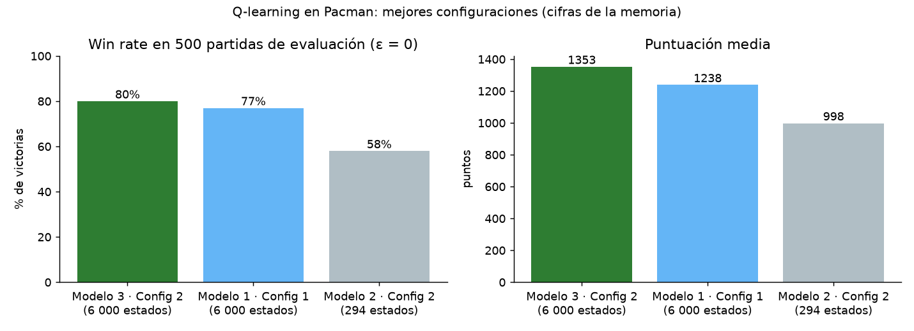

# Un Pacman que aprende solo (y otro que solo quiere cazar fantasmas)

> El mismo algoritmo, **Q-learning tabular**, y dos personalidades opuestas. Uno aprende a ganar; el
> otro, "Ghostbuster", aprende que lo único que importa es comerse fantasmas, aunque le cueste la
> partida. Lo único que cambia entre ellos es **lo que se les premia**.

| Configuración | Estados posibles | Win rate (500 partidas, ε = 0) | Puntuación media |
|---|---|---|---|
| **Recompensas 3 · Config 2** | 6 000 | **80 %** | **1 352.6** |
| Recompensas 1 · Config 1 | 6 000 | 77 % | 1 238.1 |
| Recompensas 2 · Config 2 | 294 | 58 % | 998.0 |



---

## Índice

- [Los tres ingredientes](#los-tres-ingredientes)
- [Cómo ve el mundo el agente](#cómo-ve-el-mundo-el-agente)
- [Entrenamiento](#entrenamiento)
- [Resultados](#resultados)
- [Lo que me llevo](#lo-que-me-llevo)
- [Siguientes pasos](#siguientes-pasos)
- [Cómo ejecutarlo](#cómo-ejecutarlo)

---

## Los tres ingredientes

1. **Qué recordar.** Con posiciones en bruto habría millones de estados y la tabla Q nunca se
   llenaría. Probamos 96, 128, 294, 894 y 6 000 estados: el salto de rendimiento vino de decidir *qué*
   información guardar, no de guardar más.
2. **Qué premiar.** Penalizar cada paso y premiar mucho comer fantasmas produce un agente rápido y
   agresivo; cambiar solo la recompensa produce un cazador que ni intenta ganar.
3. **Cuándo dejar de cambiar de opinión.** Un α alto al principio propaga los valores rápido;
   reducirlo después estabiliza la política.

## Cómo ve el mundo el agente

Estado discretizado en **7 variables**, 6 000 combinaciones posibles:

| Variable | Valores |
|---|---|
| Distancia al fantasma más cercano | 5 tramos (1, 3, 6, 10, >10) |
| ¿Está asustado? | sí / no |
| Dirección al fantasma | 5 |
| Dirección a la comida más cercana | 5 |
| Distancia a la comida | 4 tramos |
| ¿Cápsula a menos de 5 casillas? | sí / no |
| Paredes alrededor | 3 |

## Entrenamiento

Tres modelos de recompensa (eficiencia, exploración y agresivo) × tres configuraciones de
hiperparámetros con decaimiento de α y ε (`HYPERPARAMETERS` en `qlearning_agent.py`). Cada
configuración se entrena 9 500 episodios y se evalúa automáticamente con `evaluacion_qlearning.py`. El
win rate se mide en 500 partidas con ε = 0, separadas del entrenamiento.

## Resultados

- **Mejor configuración:** recompensas agresivas (paso −5, fantasma +150, victoria +250), α inicial 0.4
  y γ = 0.88. La penalización por paso empuja al agente a ganar rápido.
- **Curva de aprendizaje:** negativa durante los primeros ~2 000 episodios (aprende a sobrevivir), cruza
  el cero hacia los 3 000 y se estabiliza a partir de los 5 000.
- **Ghostbuster:** persigue fantasmas de forma sistemática y no gana nunca (0 %), justo lo que se
  buscaba; su mejor configuración llega a −243 de puntuación media.

## Lo que me llevo

- Con los mismos hiperparámetros, pasar de 294 a 6 000 estados lleva el win rate del 58 % al 80 %:
  **la representación del estado pesa más que cualquier ajuste fino**.
- La recompensa *es* la especificación: cambiarla basta para obtener comportamientos radicalmente
  distintos con el mismo algoritmo.

## Siguientes pasos

- Añadir al estado la dirección de movimiento de los fantasmas.
- Repetir cada configuración con varias semillas y dar media ± desviación.
- Sustituir la tabla Q por aproximación con funciones (Q-learning aproximado o DQN) para escalar a
  mapas más grandes.

## Cómo ejecutarlo

Los agentes se integran en el framework de Pacman de UC Berkeley (`pacman.py`, `game.py`,
`learningAgents.py`, `featureExtractors.py`, `util.py`…), que no se incluye aquí: copia el agente que
quieras usar como `qlearningAgents.py` dentro del framework y lanza `evaluacion_qlearning.py`
(la variable `AGENT` elige entre `SmartPacmanAgent` y `GhostbusterAgent`).

```
qlearning_agent.py         agente que juega para ganar (estado, recompensas, configuraciones)
ghostbuster_agent.py       agente cazafantasmas
evaluacion_qlearning.py    entrena y evalúa todas las configuraciones
memoria.pdf                memoria del proyecto
figures/                   gráfica de resultados
```

---

Proyecto en equipo desarrollado durante el Grado en Ingeniería de Sistemas de Inteligencia Artificial
(Universidad Francisco de Vitoria, 2025/26). Autor del repositorio: Marco Larriba Rius.
